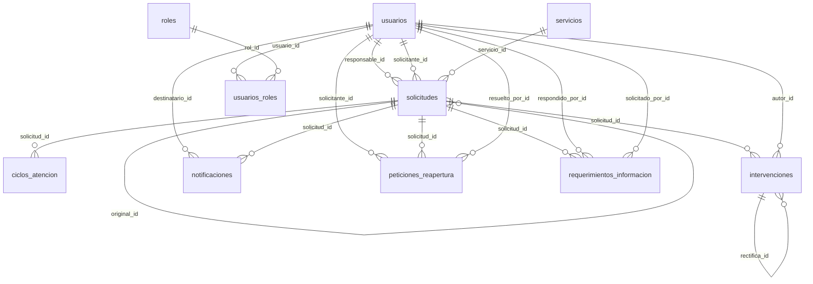
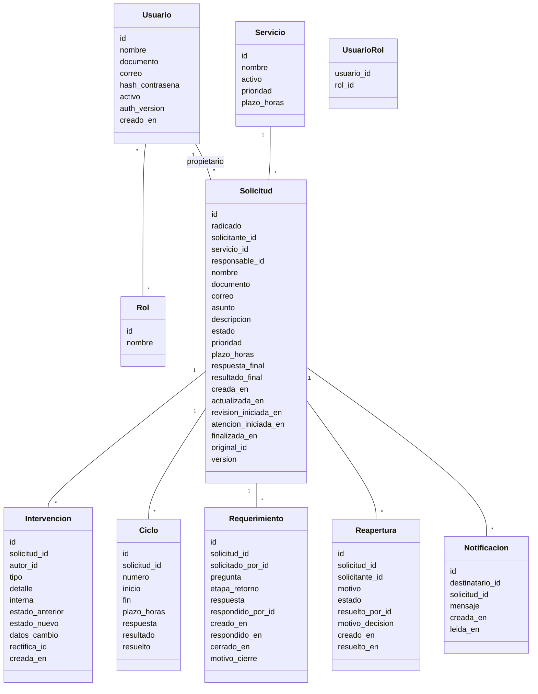
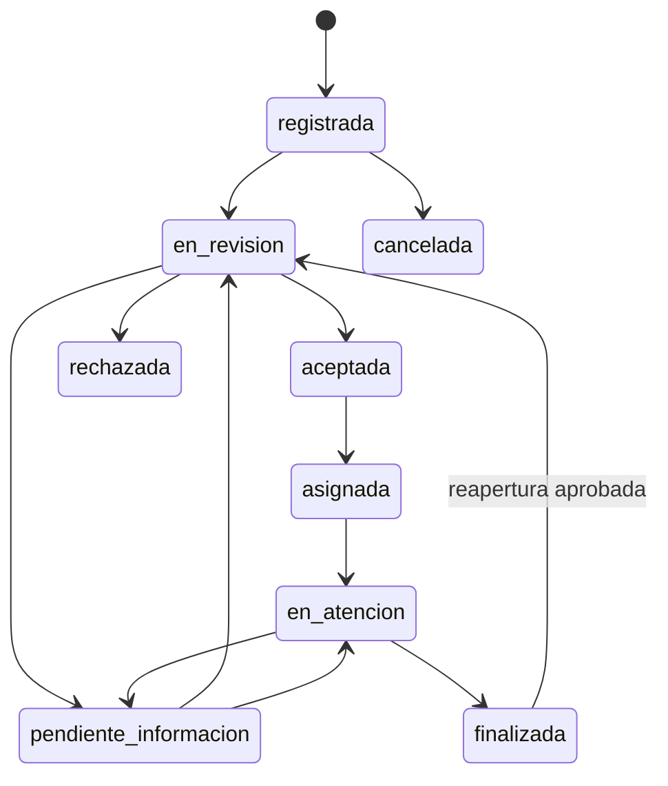

# Diseño

## Base transversal antes de migración

Navegador (HTML/CSS/JS) → rutas API → esquemas Pydantic → servicios de negocio → SQLAlchemy → SQLite. Un origen, sin CORS abierto. UTC sin zona almacenado en SQLite; serialización ISO con Z y presentación America/Bogota.

Se incorpora ciclos_atencion: cada reapertura conserva el ciclo finalizado con respuesta, resultado e inicio/fin; el nuevo ciclo permite calcular plazos y promedio solo de ciclos realmente resueltos. No sustituye el historial inmutable. Los servicios copian prioridad y plazo al registrar; su configuración posterior no cambia casos antiguos.

Restricciones: correo/radicado únicos; claves foráneas activadas; asociaciones usuario-rol con PK compuesta; índices por propietario, estado, servicio, responsable y prioridad. Índices parciales únicos impiden dos requerimientos abiertos y dos reaperturas pendientes. Control optimista con version_id_col en solicitudes. No hay cascadas de eliminación.

El esquema compartido prepara relaciones; los RF se implementan en ramas propias. La migración inicial se generará desde este esquema y se conservará como definición explícita independiente de cambios futuros del ORM.

## Diagrama ER implementado

## Modelo relacional y diccionario
UTC interno: columnas DateTime sin zona en SQLite; serialización con Z. No hay eliminación desde la API.

### roles

| Columna | Tipo SQL | Nulo | Clave / restricción |
|---|---|---|---|
| id | INTEGER | No | PK |
| nombre | VARCHAR(30) | No | UNIQUE |

### servicios

| Columna | Tipo SQL | Nulo | Clave / restricción |
|---|---|---|---|
| id | INTEGER | No | PK |
| nombre | VARCHAR(120) | No | UNIQUE |
| activo | BOOLEAN | No |  |
| prioridad | VARCHAR(10) | No |  |
| plazo_horas | INTEGER | Sí |  |

CHECK: `plazo_horas IS NULL OR plazo_horas BETWEEN 1 AND 8760`

CHECK: `prioridad IN ('baja','normal','alta')`

### usuarios

| Columna | Tipo SQL | Nulo | Clave / restricción |
|---|---|---|---|
| id | INTEGER | No | PK |
| nombre | VARCHAR(120) | No |  |
| documento | VARCHAR(30) | No |  |
| correo | VARCHAR(254) | No | UNIQUE |
| hash_contrasena | TEXT | No |  |
| activo | BOOLEAN | No |  |
| auth_version | INTEGER | No |  |
| creado_en | DATETIME | No |  |

### solicitudes

| Columna | Tipo SQL | Nulo | Clave / restricción |
|---|---|---|---|
| id | INTEGER | No | PK |
| radicado | VARCHAR(40) | Sí | UNIQUE |
| solicitante_id | INTEGER | No | FK usuarios.id |
| servicio_id | INTEGER | No | FK servicios.id |
| responsable_id | INTEGER | Sí | FK usuarios.id |
| nombre | VARCHAR(120) | No |  |
| documento | VARCHAR(30) | No |  |
| correo | VARCHAR(254) | No |  |
| asunto | VARCHAR(150) | No |  |
| descripcion | TEXT | No |  |
| estado | VARCHAR(30) | No |  |
| prioridad | VARCHAR(10) | No |  |
| plazo_horas | INTEGER | Sí |  |
| respuesta_final | TEXT | Sí |  |
| resultado_final | TEXT | Sí |  |
| creada_en | DATETIME | No |  |
| actualizada_en | DATETIME | No |  |
| revision_iniciada_en | DATETIME | Sí |  |
| atencion_iniciada_en | DATETIME | Sí |  |
| finalizada_en | DATETIME | Sí |  |
| original_id | INTEGER | Sí | FK solicitudes.id |
| version | INTEGER | No |  |

CHECK: `estado IN ('registrada','en_revision','pendiente_informacion','aceptada','asignada','en_atencion','finalizada','rechazada','cancelada','cerrada_duplicidad')`

Índice: `ix_solicitudes_responsable_id`

Índice: `ix_solicitudes_servicio_id`

Índice: `ix_solicitudes_prioridad`

Índice: `ix_solicitudes_solicitante_id`

Índice: `ix_solicitud_filtros`

### usuarios_roles

| Columna | Tipo SQL | Nulo | Clave / restricción |
|---|---|---|---|
| usuario_id | INTEGER | No | PK, FK usuarios.id |
| rol_id | INTEGER | No | PK, FK roles.id |

### ciclos_atencion

| Columna | Tipo SQL | Nulo | Clave / restricción |
|---|---|---|---|
| id | INTEGER | No | PK |
| solicitud_id | INTEGER | No | FK solicitudes.id |
| numero | INTEGER | No |  |
| inicio | DATETIME | No |  |
| fin | DATETIME | Sí |  |
| plazo_horas | INTEGER | Sí |  |
| respuesta | TEXT | Sí |  |
| resultado | TEXT | Sí |  |
| resuelto | BOOLEAN | No |  |

CHECK: `plazo_horas IS NULL OR plazo_horas BETWEEN 1 AND 8760`

Índice: `ix_ciclos_atencion_solicitud_id`

### intervenciones

| Columna | Tipo SQL | Nulo | Clave / restricción |
|---|---|---|---|
| id | INTEGER | No | PK |
| solicitud_id | INTEGER | No | FK solicitudes.id |
| autor_id | INTEGER | No | FK usuarios.id |
| tipo | VARCHAR(50) | No |  |
| detalle | TEXT | No |  |
| interna | BOOLEAN | No |  |
| estado_anterior | VARCHAR(30) | Sí |  |
| estado_nuevo | VARCHAR(30) | Sí |  |
| datos_cambio | TEXT | Sí |  |
| rectifica_id | INTEGER | Sí | FK intervenciones.id |
| creada_en | DATETIME | No |  |

Índice: `ix_intervenciones_solicitud_id`

### notificaciones

| Columna | Tipo SQL | Nulo | Clave / restricción |
|---|---|---|---|
| id | INTEGER | No | PK |
| destinatario_id | INTEGER | No | FK usuarios.id |
| solicitud_id | INTEGER | No | FK solicitudes.id |
| mensaje | TEXT | No |  |
| creada_en | DATETIME | No |  |
| leida_en | DATETIME | Sí |  |

Índice: `ix_notificaciones_destinatario_id`

### peticiones_reapertura

| Columna | Tipo SQL | Nulo | Clave / restricción |
|---|---|---|---|
| id | INTEGER | No | PK |
| solicitud_id | INTEGER | No | FK solicitudes.id |
| solicitante_id | INTEGER | No | FK usuarios.id |
| motivo | TEXT | No |  |
| estado | VARCHAR(20) | No |  |
| resuelto_por_id | INTEGER | Sí | FK usuarios.id |
| motivo_decision | TEXT | Sí |  |
| creado_en | DATETIME | No |  |
| resuelto_en | DATETIME | Sí |  |

Índice: `ix_peticiones_reapertura_solicitud_id`

Índice: `uq_reapertura_pendiente` único

### requerimientos_informacion

| Columna | Tipo SQL | Nulo | Clave / restricción |
|---|---|---|---|
| id | INTEGER | No | PK |
| solicitud_id | INTEGER | No | FK solicitudes.id |
| solicitado_por_id | INTEGER | No | FK usuarios.id |
| pregunta | TEXT | No |  |
| etapa_retorno | VARCHAR(30) | No |  |
| respuesta | TEXT | Sí |  |
| respondido_por_id | INTEGER | Sí | FK usuarios.id |
| creado_en | DATETIME | No |  |
| respondido_en | DATETIME | Sí |  |
| cerrado_en | DATETIME | Sí |  |
| motivo_cierre | TEXT | Sí |  |

Índice: `uq_requerimiento_abierto` único

Índice: `ix_requerimientos_informacion_solicitud_id`

## Clases de dominio implementadas

## Estados

Cualquier estado activo puede cerrarse por duplicidad. Reasignar conserva estado. Pedir reapertura no cambia estado. Motivos y versión son obligatorios en acciones administrativas.

## Componentes y permisos
api contiene adaptadores HTTP; schemas define entradas explícitas; services/operations_* ejecuta reglas y transacciones; models refleja tablas; db activa claves foráneas; core protege configuración/JWT/Argon2. El frontend usa textContent, token en memoria y navegación por roles. La autorización efectiva se comprueba en servidor.

Solicitante: casos propios, corrección/cancelación solo registrada, respuesta a requerimiento propio y petición de reapertura. Atención: consulta global y evaluación; gestión operativa solo como responsable. Coordinación: administración, asignación, supervisión, duplicados, reaperturas y consolidado; también requiere ser responsable para iniciar/finalizar atención. Múltiples roles acumulan permisos conservando propiedad y estado.

## Prototipos y estado visual
La interfaz real está en app/frontend. Vista de acceso/registro; navegación de solicitudes, nueva solicitud, personal, servicios, consolidado y notificaciones; detalle con formularios según estado/permisos. No se incluyen capturas inventadas: la inspección del frontend completo quedó bloqueada por permiso de navegador denegado. Probar responsive, teclado y texto malicioso con el manual antes de exposición.
